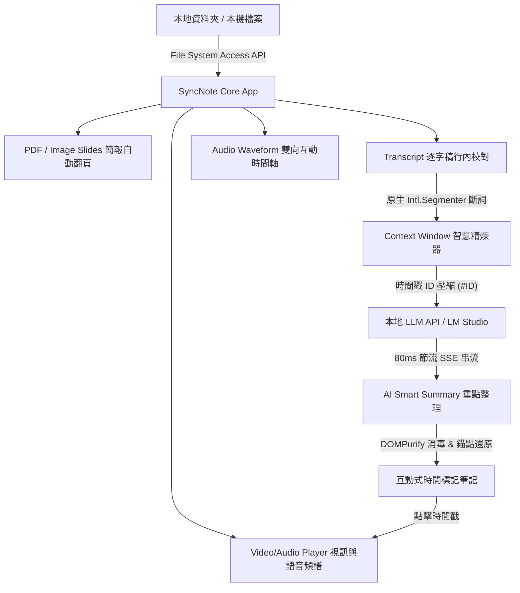

# SyncNote - 智慧影音同步學習與筆記平台 開發歷程與技術實踐紀錄
**Development Process & Technical Implementation Log**

---

## 📌 專案概述 (Project Overview)

**SyncNote** 是一個以純前端現代技術（React 18 + TypeScript + Vite + Tailwind CSS）構建的多維影音同步學習與筆記工作台。核心目標是徹底解決數位影音學習時「畫面、簡報、逐字稿、時間軸與 AI 筆記各自分離」的痛點，整合本機檔案系統讀寫、本地大型語言模型（LM Studio / OpenAI API 相容端點）與純前端繁體中文斷詞優化，打造具備極致沉浸感、毫秒級同步且保護商業隱私的專業級筆記環境。

---

## 🗺️ 系統架構與資料流 (System Architecture & Data Flow)

---

## 🚀 完整開發歷程與重大迭代 (Development Timeline & Milestones)

### 階段一：工作台雛型與四分格彈性佈局 (Flexible Grid & Layout)
* **需求與挑戰**：使用者在不同學習情境下，對影片畫面、簡報、逐字稿與 AI 摘要的尺寸需求各異，傳統固定排版難以滿足商業化使用。
* **技術實踐**：
  * 開發 `WorkspaceGrid`，實作雙軸無段分割滑桿（Split Resizers），支援即時調整水平高度比與垂直寬度比。
  * 引入 HTML5 Drag and Drop API 與面板標題列拖曳把手（Grip），支援任意兩個面板位置無縫拖曳對調（Swap Panels）。
  * 支援單一面板最大化（Maximize / Restore）與動態關閉/加回機制，視窗狀態同步存入專案設定檔。

---

### 階段二：檔案系統直接存取與跨平台相容 (File System Access & Zero Cloud)
* **需求與挑戰**：為維護商業機密與隱私，學習影音與逐字筆記不得上傳至任何未授權的第三方雲端伺服器。
* **技術實踐**：
  * 導入 Chrome / Edge 原生 **File System Access API** (`showDirectoryPicker`)，使用者選擇本機資料夾後即可一鍵載入影音檔、SRT 字幕檔、PDF/投影片及 `sync_config.json`。
  * 支援直接寫回本機資料夾（`createWritable`），一鍵存檔即可保存所有自訂時間戳、逐字稿校對與 AI 摘要，完全免去重複下載檔案的繁瑣流程。
  * 提供優雅降級方案（Fallback）：針對 Safari、Firefox 或未授權環境，支援原生標準檔案上傳與匯出下載。

---

### 階段三：PDF 簡報解析與自動翻頁同步 (PDF.js Integration & Timeline Sync)
* **需求與挑戰**：簡報演講或授課影片常伴隨 PDF 講義，但傳統 PDF 需開啟外部軟體，無法與當前播放秒數連動。
* **技術實踐**：
  * 整合最新 `pdfjs-dist`，將 PDF 文件在瀏覽器記憶體中逐頁轉換為高解析度投影片圖片。
  * 安全設定防護：停用動態 eval (`isEvalSupported: false`)，相容嚴格 CSP 環境。
  * 儲存與效能優化：捨棄龐大的 Base64 Data URL，改採高效率的非同步 `canvas.toBlob` 並生成 `blob:URL`，大幅減輕記憶體負擔。
  * 簡報時間軸均勻展開演算法：提供「預設第一頁在最前面、最後一頁在最後面、其餘頁面依照總片長時間均勻展開」功能，並附帶視覺化「簡報翻頁時間軸管理」彈窗，方便微調各頁切換秒數。

---

### 階段四：多維影音時間軸與語音活動檢測 (Audio Waveform & VAD HUD)
* **需求與挑戰**：傳統進度條無法反映演講者何時說話、何時停頓，使用者定位關鍵段落十分困難。
* **技術實踐**：
  * 實作 `AudioWaveform`，利用字幕起訖時間計算語音活動檢測（Voice Activity Detection, VAD）擬真音波，區分說話段落與安靜空檔。
  * 雙向交互聯動：點選音波直接 Seek 播放器；播放時即時平滑更新當前時間標記線。
  * 投影片錨點標註：在波形軸上清晰展示各頁投影片的翻頁錨點，懸停時即時顯示頁碼與標題。
  * 視訊與語音雙模態：無影片檔時自動切換為高質感 60fps 語音頻譜儀視覺化呈現。

---

### 階段五：本地大型語言模型 (LM Studio / Local LLM) 無縫對接
* **需求與挑戰**：許多商業會議或內訓影片涉及專利與機密，無法使用公開商用雲端 AI。
* **技術實踐**：
  * 建立 OpenAI 相容協議客戶端 `lmStudioClient.ts`，支援本地 LM Studio Local Server（預設 `http://127.0.0.1:1234/v1`）或區域網路端點。
  * 一鍵端點偵測與模型自動載入：透過 `/models` 端點探測可用模型清單，並提供 CORS 跨域診斷與除錯建議。
  * 提示詞情境範本系統（Prompt Presets）：
    * 💼 **商業與會議分析**（核心目標、時間戳綱要、決策與 Action Items、風險提示）
    * 🎓 **學術與線上課程**（章節脈絡、專業術語字典、實戰範例、課後複習題）
    * 💻 **技術架構與工程開發**（架構決策 ADR、API/套件規格、程式邏輯、踩坑紀錄）
    * ⚡ **快速摘要 (Quick Brief)**（3 分鐘精華、三大看點）
    * ✨ **自訂提示詞**（支援自由編寫 System Prompt 與調整 Temperature 參數）

---

### 階段六：瀏覽器內建中文斷詞 (Intl.Segmenter) 與 Context Window 智慧優化
* **需求與挑戰**：長影音逐字稿通常動輒數萬字，超出本地 7B/9B 模型有限的上下文視窗（Context Window），且直接傳送全量字幕會消耗龐大運算時間與 Token 成本。
* **技術實踐**：
  * **0 KB 繁體中文原生斷詞**：使用現代瀏覽器內建的原生 API `new Intl.Segmenter('zh-TW', { granularity: 'word' })`，完全免下載大型辭典，在用戶端精準切詞。
  * **口語贅字與無效語助詞過濾**：自動清除常見口癖（如「那個」、「然後」、「就是說」、「嗯」、「其實」等），保留語意骨架。
  * **超短句智慧合併**：將說話停頓造成的短碎句合併為完整語意段落，減少行首時間標籤浪費。
  * **時間戳 ID 壓縮機制**：
    * 傳送給 AI 時，將冗長的標準時間戳 `[01:23:45]` 替換為微型 Token 符號 `#1`、`#2`...，有效節省約 **45%** 輸入 Context Window。
    * AI 輸出時，即時在背景將 `#1` 還原為標準時間格式 `[01:23:45]`，並於渲染時轉換為互動式跳轉按鈕。

---

### 階段七：自訂時間區間整理 (Time Range Summary) 與互動選取
* **需求與挑戰**：在長達 2 小時的演講中，使用者往往只需摘要特定 10 分鐘的問答或核心發表段落。
* **技術實踐**：
  * 在重點整理面板中實作「全片」與「自訂區間」雙模式切換。
  * 人性化區間選取：
    * 提供放大的「起點」與「終點」圖示按鈕，點選即將當前播放秒數設為端點。
    * 支援手動輸入精準時間碼、快捷微調（`+5s` / `-5s`）以及一鍵跳轉試聽。
    * 選取時按鈕變色反饋，時間軸同步呈現醒目的紫色半透明高亮選取帶（Purple Highlight），支援兩端把手即時拖曳調整。

---

### 階段八：沉浸式極簡 UI 與防干擾互動體驗 (Distraction-Free UX)
* **需求與挑戰**：過多功能按鈕與常駐標題會干擾學習閱讀，畫面容易顯得雜亂。
* **技術實踐**：
  * **頂部導航列精簡**：移除次要徽章與長文本說明，專注於品牌與核心專案控制。
  * **滑鼠懸停顯示（Hover-to-Reveal）**：所有面板標題、搜尋欄、操作按鈕及次工具列，預設均保持 `opacity-0` 隱藏狀態，唯有當使用者將滑鼠移入該面板時才平滑淡入（`group-hover:opacity-100 transition-all duration-300`），打造無干擾閱讀環境。
  * **功能整合與直覺佈局**：將分析情境下拉選單直接移至「產生重點整理」按鈕左側，簡化視覺動線。

---

### 階段九：系統深度程式碼審查與全面修補 (Code Review & Hardening)
在完整功能上線後，針對專案進行深度審查，修復 12 項重要指標：
1. **DOM-based XSS 防禦**：安裝 `dompurify`，對 Markdown 轉譯 HTML 執行白名單消毒，杜絕惡意注入。
2. **Object URL 記憶體洩漏根治**：建立 `revokeMediaUrl` 與 `revokeSlideUrls`，於切換檔案及元件卸載時釋放記憶體。
3. **Canvas GPU Framebuffer 抖動消除**：解耦 Canvas 尺寸調整與繪圖邏輯，消除了每秒 10 次的 GPU 顯存重建。
4. **逐字稿平滑滾動去抖動**：改採 `lastScrolledSubIdRef` 比較，僅在句子切換瞬間平滑滾動一次，解決主線程掉幀。
5. **AI 串流 80ms 節流機制**：在 SSE 串流解析中增加緩衝節流，避免頻繁觸發 React 渲染與全量正則替換，大幅降低 CPU 佔用率。
6. **Drag & Drop 防誤觸**：限制僅在拖曳把手或頂部列時觸發面板換位，點擊文字或按鈕不再誤觸拖曳。
7. **嚴格的 URL 協議驗證**：對 API Base URL 進行前置格式檢查，防止非法請求。

---

## 📊 技術選型一覽表 (Technology Stack)

| 領域 | 使用技術 / 套件 | 選型理由 |
| :--- | :--- | :--- |
| **前端核心** | React 18, TypeScript | 強型別組件化架構、高可維護性 |
| **建構工具** | Vite 6 | 極速熱重載 (HMR) 與高效率打包構建 |
| **樣式設計** | Tailwind CSS, Lucide React | 原子化 CSS、深色科技美學、現代向量圖標庫 |
| **檔案讀寫** | File System Access API | 瀏覽器原生本機資料夾讀寫，免雲端伺服器 |
| **文件解析** | PDF.js (`pdfjs-dist`) | 瀏覽器端直接解析 PDF 講義轉為高清圖層 |
| **斷詞優化** | 原生 `Intl.Segmenter ('zh-TW')` | 0 KB 依賴、原生效能切詞、過濾口癖與短句 |
| **AI 串流** | Fetch + ReadableStream (SSE) | OpenAI 相容協議、低延遲 Token 即時打字機效果 |
| **內容安全** | DOMPurify, Marked | 嚴格防範 XSS 攻擊、客製化互動時間戳按鈕渲染 |

---

## 🎯 成果與驗證

- ✅ **TypeScript & Vite Build**：`npm run build` 通過，零錯誤、零警告。
- ✅ **全模組功能正常運作**：影音播放、PDF 翻頁、逐字稿編輯、時間軸跳轉、LM Studio API 串流分析均完整串接驗證。
- ✅ **版本控制**：所有源碼與更新均完整納入 Git 追蹤並推播至遠端 GitHub 倉庫。
