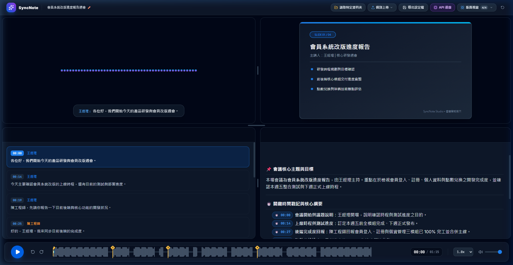
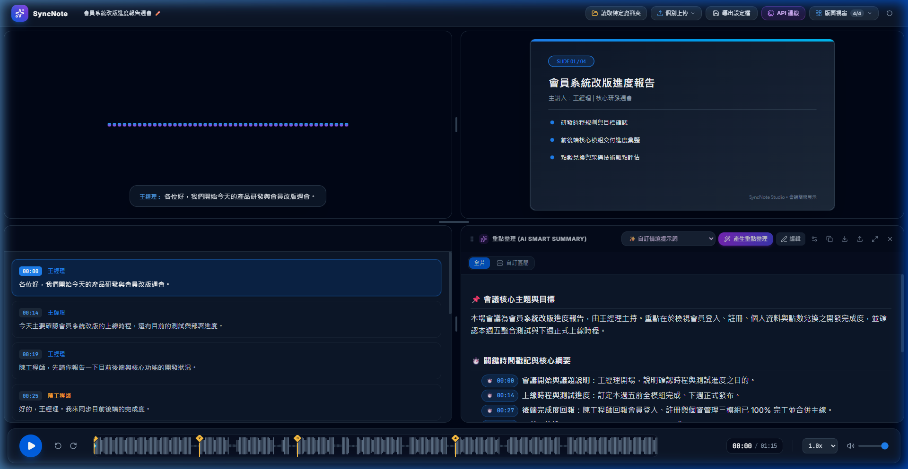
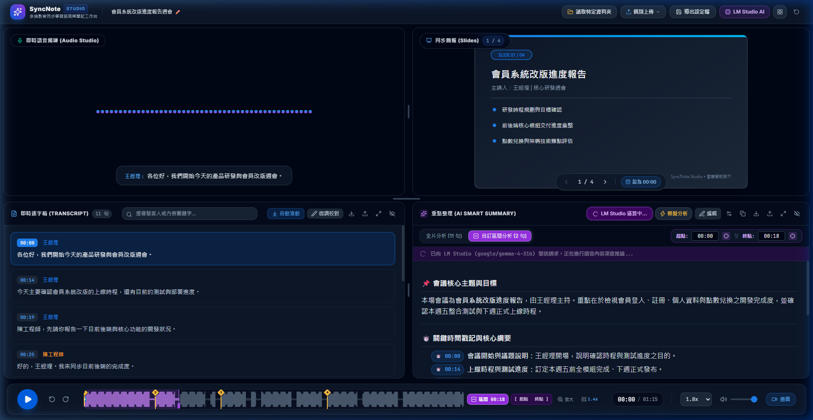
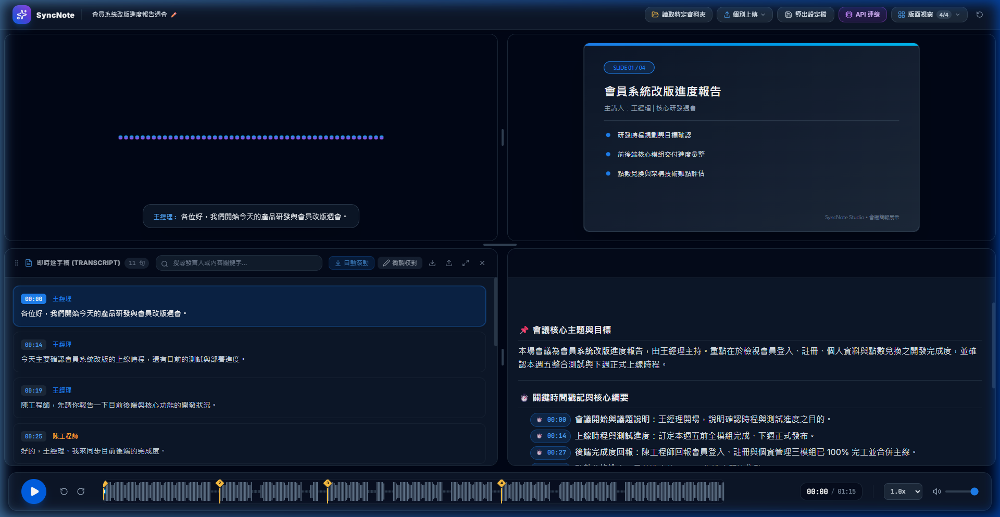
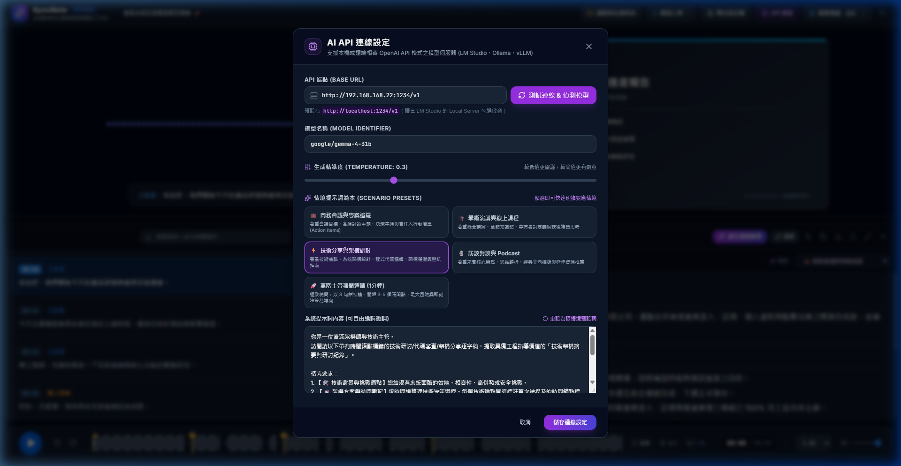

# SRTNote - 智慧影音同步學習與筆記工作台

<div align="center">


[](https://github.com/etsaycood/SRTNote/actions/workflows/deploy.yml)

**集合視訊、簡報、逐字稿與 AI 筆記邊界的沉浸式學習工作台**  
純前端本地運行・零資料上雲・原生中文斷詞優化・毫秒級多維時間同步・手機平板完美適配

🔗 **線上展示網址**：[**https://etsaycood.github.io/SRTNote/**](https://etsaycood.github.io/SRTNote/)

[✨ 核心特色](#-核心特色) • [📸 介面預覽](#-介面預覽) • [🚀 快速啟動](#-快速啟動) • [🤖 本地-ai-設定指南](#-本地-ai-設定指南) • [📖 開發歷程紀錄](#-開發歷程與技術細節)

</div>

---

## 📸 介面預覽

### 🖥️ 沉浸式四分格工作台 (主畫面總覽)
平時自動隱藏操作功能鍵與標籤，呈現最純粹的影音與筆記畫面；滑鼠懸停即平滑浮現控制列。


### 🤖 本地 AI 重點整理 (情境切換 & 互動時間戳)
支援多種情境提示詞範本（商業會議、學術課程、技術架構、自訂提示詞），AI 筆記內所有時間戳 `[MM:SS]` 均可點擊直接跳轉播放。


### ⏱️ 自訂時間區間整理 (雙向聯動高亮波形軸)
支援「全片」與「自訂區間」雙模式，一鍵將當前秒數設為起訖點，時間軸同步呈現紫色高亮範圍。


### 📝 即時逐字稿搜尋與行內校對
內建語意搜尋、自動平滑滾動（去抖動設計），支援以 `+0.5s` / `-0.5s` 微調字幕時間與即時匯出標準 `.srt`。


### ⚙️ 本地 LLM API 連線與自動模型偵測
直接串接本地 LM Studio 或任何 OpenAI 相容端點，保護商業隱私，免金鑰、免雲端成本。


---

## ✨ 核心特色

### 1. 📁 本機資料夾直接存取 (File System Access API)
- **零上傳雲端**：直接在電腦上選取工作專案資料夾，自動載入並識別影音檔（MP4/WebM/MP3/WAV）、字幕檔（SRT/VTT）、簡報講義（PDF/PNG/JPG）與專案檔（`sync_config.json`）。
- **一鍵存檔回寫**：編輯逐字稿或時間戳後，點擊「存檔至資料夾」直接寫回目錄，免去反覆下載檔案。
- **跨平台相容降級**：非 Chromium 核心環境提供標準檔案選擇與匯出備用方案。

### 2. ⚡ 原生繁體中文斷詞 (Intl.Segmenter) 與 Context Window 智慧精煉
- **0 KB 斷詞引擎**：採用瀏覽器原生 `Intl.Segmenter('zh-TW', { granularity: 'word' })`，不需打包任何龐大第三方詞庫。
- **Token 壓縮省電達 45%**：自動清除口癖虛詞（如「那個」、「然後」、「就是說」等）與短碎句合併。
- **時間戳記 ID 化壓縮機制**：以 `#1`、`#2` 取代冗長秒數字串，大幅突破本地 7B/9B 小型模型有限的上下文視窗。

### 3. 🎯 四維時間毫秒級精準同步
- **播放器、簡報、逐字稿與音波活動檢測 (VAD) 四向連動**。
- 點選逐字稿任意一行、簡報頁碼或 AI 筆記的時間膠囊按鈕，影音毫秒級同步跳轉。
- 60fps 平滑音頻頻譜 HUD，無影片時自動切換為高質感語音波形動畫。

### 4. 🔒 嚴格企業級資安與高效能渲染架構
- **DOMPurify 白名單消毒**：徹底阻絕 Markdown 渲染中的 XSS 攻擊。
- **記憶體洩漏根治**：嚴格控管 `URL.revokeObjectURL`，釋放長影片與多頁 PDF 的暫存空間。
- **GPU Framebuffer 最佳化**：解耦 Canvas 尺寸與播放繪圖，徹底消除 GPU 顯存重置抖動。
- **80ms 串流節流緩衝**：確保 AI 即時輸出時 UI 主執行緒保持 60fps 順暢。

### 5. 📱 手機與平板專屬沉浸模式 (Mobile Workspace Grid)
- **智慧裝置自動偵測**：自動感測行動裝置（UserAgent、Touch Points、窄螢幕 `<= 820px`），亦可隨時點擊頂部「手機模式」手動切換。
- **直立上下分欄**：手機直立時採用上下雙窗格（預設上方影音、下方即時逐字稿），兼顧影片觀看與筆記閱讀。
- **左右滑動切換分頁**：同一個窗格開啟多個面板時，支援左右滑動切換標籤分頁，維持手機畫面的簡潔流暢。
- **YouTube 式浮動控制器**：影片面板內建輕量控制列與進度軸，播放時數秒後自動淡出隱藏；手機模式下自動隱藏底層 Master 播放列，釋放最大螢幕範圍。

### 6. 📺 YouTube 多影片批次解析、瀏覽器歷史庫與播放清單輪播
- **批次連結解析**：支援一次貼入多組 YouTube 網址或混雜文字，正則自動擷取所有有效的 11 碼影片 ID。
- **獨立本機影片庫**：所有觀看過的 YouTube 影片自動記錄於瀏覽器 LocalStorage，避免設定檔過大。
- **自訂排序與過濾**：影片清單支援「拖曳把手（Drag & Drop）」或「▲ / ▼ 按鈕」自訂排序，並提供即時 ID 搜尋過濾。
- **播放清單輪播與循環模式**：自由勾選多部影片加入播放清單，支援「關閉」、「單曲循環」與「全部循環」三段式切換。
- **高可靠結尾偵測跳轉**：加入 120ms 高頻輪詢雙重保險門檻（結尾前 0.45 秒判定）與 React 狀態保護，解決 YouTube 結尾推薦卡片阻斷 `ENDED` 事件的通病，100% 穩定接續自動播放下一部。

### 7. 📑 影片專屬逐字稿與簡報獨立綁定 (Per-Video Media Mapping)
- **多影片獨立對應**：每部 YouTube 影片皆可獨立擁有專屬的 SRT 逐字稿與 PDF/圖片簡報（`subtitlesByMedia`、`slidesByMedia`）。
- **切換影片自動記憶還原**：影片輪播或手動切換時，自動載入該影片的專屬資料；未上傳時明確呈現提示，影片庫亦直觀標示 `SRT (N)` 與 `簡報 (N)`。

### 8. ⛓️‍💥 簡報暫停同步與自由翻頁閱讀 (Slide Sync Pause Mode)
- **簡報懸浮控制器切換**：簡報底部懸浮導覽列新增 `[ 🔗 同步中 ]` / `[ ⛓️‍💥 暫停同步 ]` 切換按鈕。
- **自由翻閱不被強制拉回**：暫停同步時可自由點選「上一頁/下一頁」仔細研讀投影片或筆記，影音播放時不會強制跳回目前秒數；隨時點擊即可重新與影音進度同步。


### 9. 📐 強化 Markdown 數學符號與公式排版 (KaTeX / LaTeX Engine)
- **KaTeX 原生支援**：內建 marked-katex-extension 與 KaTeX 數學引擎，支援行內公式（如 $E = mc^2$）、流程標記與多行公式塊。
- **無縫符號轉換**：各類流程箭頭（如 $\rightarrow$ 轉換為 **→**、$\Rightarrow$ 轉換為 **⇒**）皆可流暢顯示，適合技術流程圖與演算法教學整理。
- **雙向資安消毒**：DOMPurify 完整白名單放行 MathML 與 SVG 符號節點，兼顧數學排版與防 XSS 資安保護。

### 10. ⚡ AI 即時三階段狀態指示器與極速 Token 預估
- **三階段真實狀態指示**：徹底移除不實的預估秒數與假進度條，改採 **① 資料精煉** (贅字去除/ID打點) → **② 思考推論** (模型思考/TTFT) → **③ 串流生成** (即時產出字數統計 + 打字機效果) 狀態膠囊與無確定進度流光特效。
- **前端 <1ms Token 預估**：即時依中文字元 (~1.6 tokens) 與英數字詞 (~1.3 tokens) 評估目前字幕量。
- **上下文超限防呆警示**：提供「模型上下文長度限制 (Context Window)」設定；當內容超出時自動跳出應對指引（支援「切換為自訂時間區間整理」、「仍要嘗試全量發送」或「調整 API 設定」）。

### 11. 🔗 雲端分享連結雙模式 (Cloud Share & Auto-Routing ?s=p_, d_, j_)
- **多平台直連與智慧分流**：
  - **?s=p_代號**（[Pastes.dev](https://pastes.dev)）：上限 ~10 MB，支援大量影片紀錄與長篇逐字稿。
  - **?s=d_代號**（[dpaste.com](https://dpaste.com)）：上限 ~1 MB，免預檢高相容表單儲存。
  - **?s=j_代號**（[JSONBlob](https://jsonblob.com)）：備援輕量儲存。
- **雙模式分享（內容不含簡報，確保超輕量）**：
  - **當前影片 + 逐字稿 + 重點整理分享**：完整分享當前播放的 YouTube 影音、逐字稿字幕與 AI 重點整理筆記。
  - **YouTube 影片記錄分享**：一鍵分享整組已儲存的 YouTube 影片清單（包含自訂排序）與輪播佇列，並可勾選是否一併包含各影片綁定之 SRT 字幕。
- **開啟分享連結自動隱藏簡報面板（選項 1-A）**：
  - 開啟 ?s=... 網址時，系統自動將「同步簡報」面板關閉隱藏，以「影音視窗 + 即時逐字稿 + 重點整理」三窗格極簡呈現，同時於頂部提供狀態列與原始 JSON 檢視入口。

### 12. 🧠 互動心智圖面板 (NotebookLM 風格卡片式階層樹)
- **獨立工作區面板**：可隨時從頂部導覽列、`重點整理` 面板標題列或「版面視窗開關」開啟 **「互動心智圖」** 面板（亦可關閉同步簡報面板改以心智圖搭配筆記檢視）。
- **雙語法自動解析**：自動將 `重點整理` 的標準 Markdown（`# / ##` 標題、`- / 1.` 清單與粗體重點）或貼上的 Mermaid `mindmap` 縮排語法轉換為由左至右的貝茲曲線卡片心智圖。
- **預設展開前 2～3 層**：開啟時預設展開前 2 層分支（保持畫面清爽易讀），並提供 `1層` / `2層` / `3層` / `全展開` 快速切換與個別節點右側數量徽章收合/展開。
- **無段縮放、拖曳平移與節點聚焦放大**：支援滑鼠滾輪以游標為中心無段縮放、畫布自由拖曳、雙擊節點（或點擊 `🔍`）自動展開並放大聚焦至該節點與子分支。
- **時間戳膠囊連動跳轉**：節點內所有 `[MM:SS]` 時間戳記均渲染為可點擊膠囊按鈕（`⏱️ MM:SS`），點擊直接跳轉影片時間軸並隨播放進度高亮。

---

## 🚀 快速啟動

### 系統需求
- Node.js 18.0 或以上版本
- 現代主流瀏覽器（推薦 Chrome、Edge、Brave 等支援 File System Access API 之瀏覽器）

### 安裝與執行

```bash
# 1. 複製專案
git clone https://github.com/etsaycood/SRTNote.git
cd SRTNote

# 2. 安裝相依套件
npm install

# 3. 啟動本機開發伺服器
npm run dev

# 4. 建置生產環境版本
npm run build
```

啟動後請使用瀏覽器開啟 `http://localhost:3000/`。

---

## 🤖 本地 AI 設定指南 (LM Studio)

本系統支援任何相容 OpenAI `/v1/chat/completions` 規範的本地伺服器：

1. 下載並開啟 [LM Studio](https://lmstudio.ai/)。
2. 下載推薦開源模型（例如 `Qwen2.5-7B-Instruct`、`Gemma-2-9B-It` 或 `Llama-3.1-8B-Instruct`）。
3. 切換至 LM Studio 左側選單的 **Developer / Local Server**，點選 **Start Server**：
   - 預設端點為 `http://127.0.0.1:1234/v1`
   - 請確認開啟 **Enable CORS**（允許跨域存取）。
4. 回到 SRTNote 網頁，點選右上角 **⚙️ 系統設定 → AI 連線設定**：
   - 點擊「**測試連線 & 偵測模型**」，系統將自動抓取當前已載入之模型。
   - 選擇所需分析情境（商業會議、線上課程、技術架構或自訂）。
5. 點擊「**產生重點整理**」，享受零延遲、高隱私的即時串流筆記體驗！

---

## 📖 開發歷程與技術細節

本專案歷經架構重構、原生中文斷詞整合、Context Window 壓縮與全面資安代碼審查，詳細設計決策與演進歷程請參閱：
- 📄 [完整開發歷程紀錄 (DEVELOPMENT_LOG.md)](./DEVELOPMENT_LOG.md)
- 🛡️ [資安審查與修復報告 (CODE_REVIEW_AND_PATCH_REPORT.md)](./CODE_REVIEW_AND_PATCH_REPORT.md)

---

## 📄 開源授權

本專案基於 [MIT License](LICENSE) 條款開源發布。
